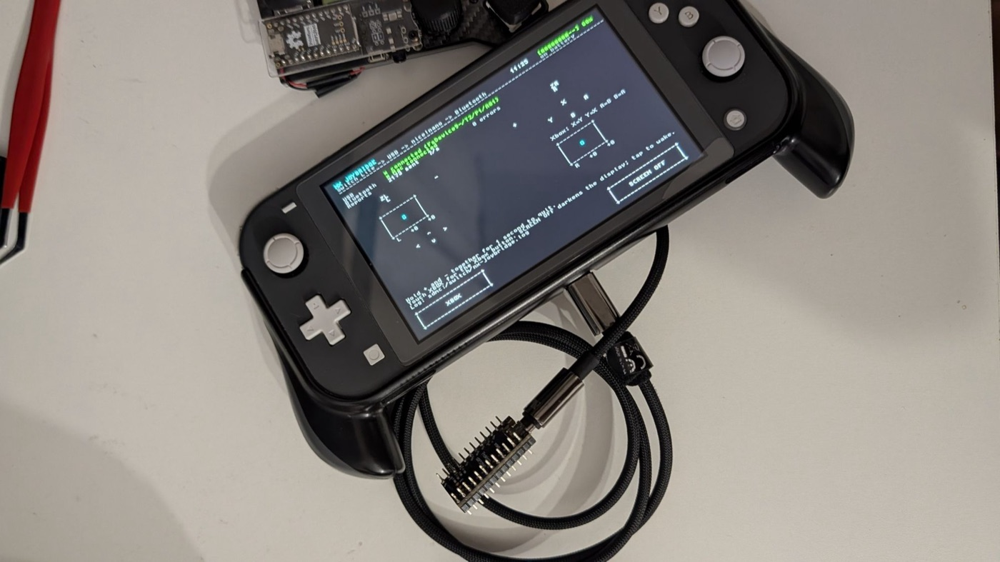
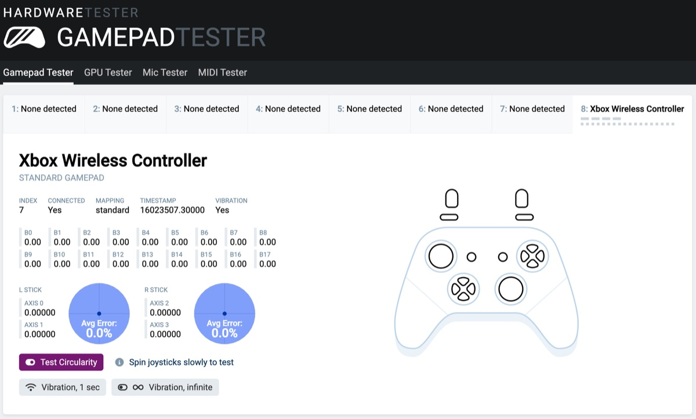
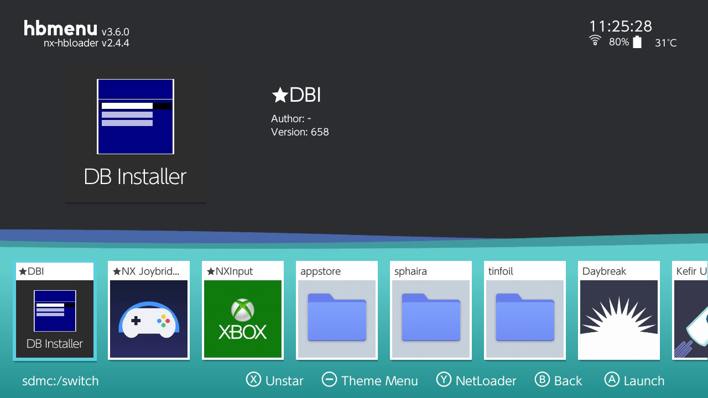
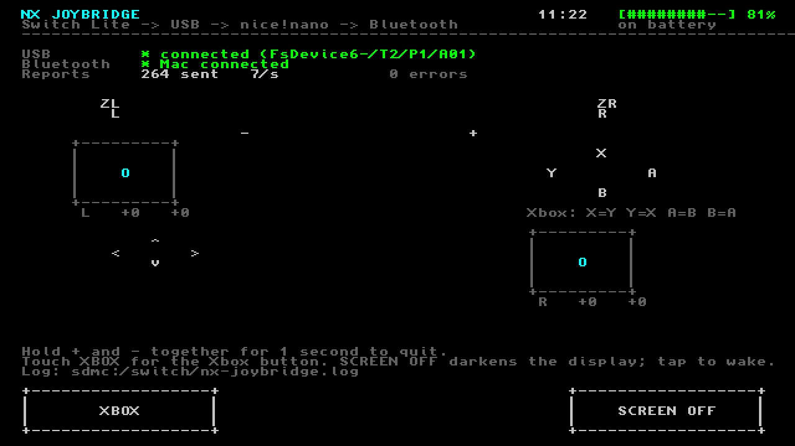

# nx-joybridge

Use a homebrew Nintendo Switch (tested on a Switch Lite) as a Bluetooth game
controller for a Mac. The Mac sees a standard **Xbox Wireless Controller**, so
anything that supports Xbox pads works: games, browsers, emulators.

A small nRF52840 board (a [nice!nano](https://nicekeyboards.com/nice-nano/) or
compatible) does the Bluetooth part. The Switch talks to it over a USB cable.

```
Switch ──USB cable──▶ nice!nano ──Bluetooth LE──▶ Mac: "Xbox Wireless Controller"
 (NX Joybridge app)    (xbox_bridge firmware)
```



## Status

Working, tested with:

- Nintendo Switch Lite with Atmosphère custom firmware
- nice!nano clone (nRF52840, UF2 bootloader 0.6.0, SoftDevice S140 6.1.1)
- macOS 27; recognised by Apple's GameController framework as an Xbox controller,
  works on gamepad-tester sites and in World of Warcraft (retail)



Every control maps through, including both analog sticks and the Xbox button.
Other operating systems should see an ordinary Bluetooth Xbox controller, but are
untested.

## Why the extra board?

- **macOS** only accepts real hardware of known controller models as game
  controllers. Software-made ("virtual") controllers need a restricted Apple
  entitlement and are ignored by the GameController framework.
- **The Switch** can't act as a Bluetooth controller itself: its Bluetooth stack
  refuses to run the needed GATT service for homebrew (see
  [docs/FINDINGS.md](docs/FINDINGS.md)).

A cheap nRF52840 board imitating an Xbox controller solves both.

## What you need

| Item | Notes |
|------|-------|
| Nintendo Switch with custom firmware | [Atmosphère](https://github.com/Atmosphere-NX/Atmosphere) with the Homebrew Menu. Tested on a Lite. |
| nRF52840 board with the Adafruit UF2 bootloader | nice!nano or a clone. It must have SoftDevice S140 6.1.1, check `INFO_UF2.TXT` on its USB drive. |
| USB-C cable | Switch to board. A plain USB-C to USB-C cable worked; use an OTG adapter if your board doesn't power up. |
| Mac with Bluetooth | For building: devkitPro, `arduino-cli`, Python 3. |

## Quick start

Pre-built `xbox_bridge.uf2` and `nx-joybridge.nro` are attached to each
[release](../../releases); you only need to build from source to change the code.

1. **Flash the board** with the bridge firmware ([build it](#nicenano-firmware)).
   Double-tap its reset button so the `NICENANO` drive appears, then copy
   `xbox_bridge.uf2` onto it. The board reboots by itself.
2. **Pair it with the Mac:** System Settings → Bluetooth →
   "Xbox Wireless Controller" → Connect. The board needs power for this, from the
   Mac's USB or the Switch.
3. **Install NX Joybridge on the Switch** ([build it](#switch-app)): copy
   `nx-joybridge.nro` to `/switch/` on the SD card.

   

4. **Play:** start NX Joybridge from the Homebrew Menu and plug the board into the
   Switch. The status screen shows the USB link and the Bluetooth connection.

   

### NX Joybridge controls

- All Switch controls are sent as the matching Xbox controls, by position
  (Switch B = Xbox A, A = B, Y = X, X = Y). See [docs/BRIDGE.md](docs/BRIDGE.md).
- Hold the on-screen **XBOX** button for the Xbox button (the Switch's own HOME
  button is reserved by the system).
- Tap **SCREEN OFF** to turn the display off and save battery; tap anywhere to wake it.
- Hold **+** and **−** together for 1 second to quit. The Mac sees Menu + View
  for that second, then neutral.
- The screen shows the clock, battery, link status, reports per second and a live
  view of the controls. Setup steps are logged to `/switch/nx-joybridge.log`.

## Other modes

### Wi-Fi mode (no cable on the Switch)

The [NXInput](https://github.com/Vins98/NXInput) homebrew app sends the Switch's
input over Wi-Fi; `receiver/` on the Mac passes it to the board over USB.

```
Switch ──Wi-Fi──▶ Mac: receiver ──USB──▶ nice!nano ──Bluetooth LE──▶ Mac
 (NXInput)
```

```sh
python3 -m venv .venv && source .venv/bin/activate
python3 -m pip install -r receiver/requirements.txt
python3 receiver/nxinput_receiver.py --gamepad      # finds the board on USB
```

In NXInput, enter the Mac's IP address (`ipconfig getifaddr en0`); both devices
must be on the same network. The protocol is documented in
[docs/PROTOCOL.md](docs/PROTOCOL.md).

### Keyboard mode (no extra board)

`python3 receiver/nxinput_receiver.py` turns NXInput's input into key presses
(left stick WASD, D-pad arrows, A/B/X/Y → L/K/I/J, ...). Grant Accessibility
permission to your terminal. Customise with `--dump-config > mapping.json`, edit,
then `--config mapping.json`.

## Building from source

### nice!nano firmware

Install the Adafruit nRF52 core for `arduino-cli` (tested with version 1.7.0;
the Arduino IDE also bundles an `arduino-cli`):

```sh
arduino-cli config add board_manager.additional_urls \
  https://adafruit.github.io/arduino-board-index/package_adafruit_index.json
arduino-cli core update-index
arduino-cli core install adafruit:nrf52
```

Build and convert to UF2. The board target is *Adafruit Feather nRF52840 Express*,
which shares the nice!nano's chip, bootloader layout and SoftDevice:

```sh
FW=nicenano/xbox_bridge
arduino-cli compile --fqbn adafruit:nrf52:feather52840 --output-dir $FW/build $FW
UF2CONV=$(ls "$(arduino-cli config get directories.data)"/packages/adafruit/hardware/nrf52/*/tools/uf2conv/uf2conv.py | tail -1)
python3 "$UF2CONV" -f 0xADA52840 -c -o $FW/build/xbox_bridge.uf2 $FW/build/xbox_bridge.ino.hex
```

Re-flashing later doesn't need the reset button: with the board on the Mac's USB,
`python3 receiver/bridge_cmd.py bootloader` brings up the `NICENANO` drive. (An
"extended attributes" error from `cp` when copying the file is harmless.)

### Switch app

Requires [devkitPro](https://devkitpro.org/wiki/Getting_Started) with `switch-dev`:

```sh
cd switch_app && make          # -> nx-joybridge.nro
```

To skip the SD card: open the Homebrew Menu, press **Y** (NetLoader), then
`$DEVKITPRO/tools/bin/nxlink -a <switch-ip> nx-joybridge.nro`.

### Tests

Only Python 3 and a C compiler are needed:

```sh
(cd receiver && python3 -m unittest test_receiver test_xbox_bridge)
python3 switch_app/tests/crosscheck.py     # C mapping vs Python mapping, byte for byte
```

`nicenano/check_gamecontroller.swift` prints what macOS's GameController framework
receives: `swiftc -O nicenano/check_gamecontroller.swift -o check_gamecontroller && ./check_gamecontroller 20`.
`receiver/fake_switch.py` stands in for NXInput when testing without a Switch.

## Limitations

- Xbox identity only. PlayStation controllers use classic Bluetooth, which the
  nRF52840 doesn't have.
- No rumble, no motion controls.
- The Switch's USB port is taken while playing, so it can't charge at the same time.
- End-to-end latency hasn't been measured. Bluetooth adds roughly 7.5–15 ms.
- macOS may show the Xbox button's own system action (for example a game overlay)
  instead of passing it to a game.

## No piracy

nx-joybridge is homebrew for a console you own and have modified yourself. It is an
input device and nothing else. It contains no Nintendo code, keys, firmware or
game data, and it does not:

- bypass or weaken any console protection,
- help obtain console keys, firmware or game files,
- run games anywhere other than where they are licensed to run.

Issues and pull requests about any of these will be closed.

## Safety and legal

- **Custom firmware** on a Switch is at your own risk. Consoles running it can be
  banned from Nintendo's online services; prefer an emuMMC and keep it offline.
- **Device identity:** the firmware presents Microsoft's Xbox controller
  identifiers so that operating systems recognise it. It is meant for personal
  use with your own devices.
- **Game rules:** this is an input device. It doesn't read game memory or
  automate play. Check the terms of the games you play.
- Not affiliated with or endorsed by Nintendo, Microsoft, Blizzard or Nice
  Keyboards. Trademarks belong to their owners.
- No warranty, see [LICENSE](LICENSE).

## Repository layout

| Path | What it is |
|------|------------|
| `switch_app/` | NX Joybridge, the Switch homebrew app (C, libnx) |
| `nicenano/xbox_bridge/` | Bridge firmware: Xbox controller over Bluetooth LE, input from USB serial |
| `nicenano/check_gamecontroller.swift` | Shows what macOS's GameController framework sees |
| `receiver/` | Mac receiver for NXInput (Wi-Fi and keyboard modes), bridge tools, tests |
| `docs/BRIDGE.md` | Bridge serial protocol, report layout, button mapping, failsafes |
| `docs/PROTOCOL.md` | NXInput's network protocol |
| `docs/FINDINGS.md` | What was tried and why the dead ends failed |
| `docs/COMBAT_LOG_PANEL.md` | Plan: WoW combat stats on the NX Joybridge screen |
| `experiments/switch-ble-spike/` | Dead end kept for reference: the Switch as a Bluetooth LE peripheral |

## Roadmap

- WoW combat-log panel on the Switch screen ([plan](docs/COMBAT_LOG_PANEL.md))
- Latency measurement
- Prebuilt releases (`.nro` and `.uf2`)

## Contributing

Issues and pull requests are welcome, see [CONTRIBUTING.md](CONTRIBUTING.md).

## License and credits

MIT, see [LICENSE](LICENSE). Third-party work and notices are listed in
[THIRD_PARTY_NOTICES.md](THIRD_PARTY_NOTICES.md), notably:

- [ESP32-BLE-CompositeHID](https://github.com/Mystfit/ESP32-BLE-CompositeHID) (MIT):
  the Xbox HID descriptor and IDs
- [NXInput](https://github.com/Vins98/NXInput) by Vins98 / WerWolv: the Wi-Fi mode client
- [libnx](https://github.com/switchbrew/libnx) and devkitPro: Switch homebrew toolchain
